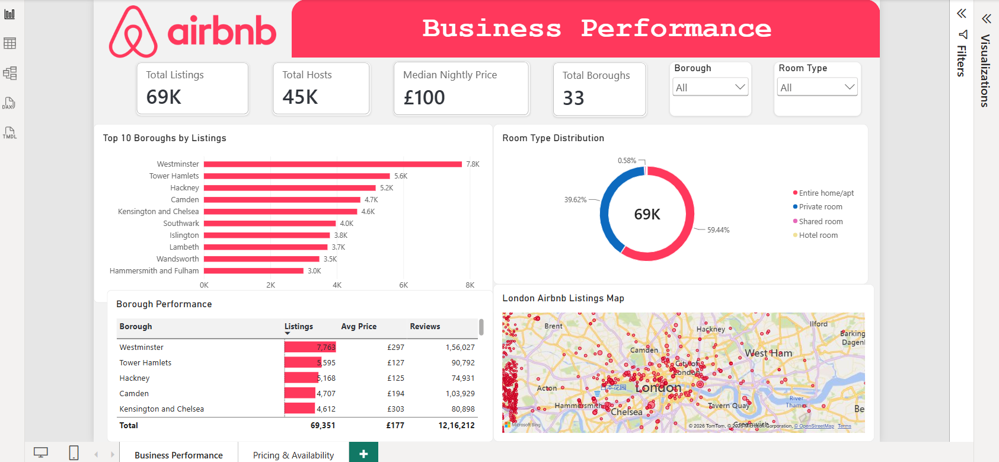
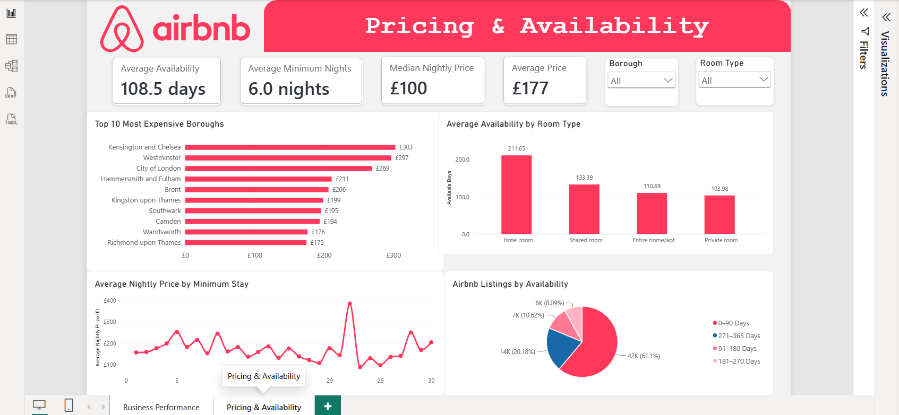

# London Airbnb Market Analysis | Power BI Dashboard

## Project Overview

This project explores the London Airbnb market using an interactive Power BI dashboard to analyse property listings, pricing trends, accommodation availability and borough-level performance.

The dashboard is divided into two pages: **Business Performance** and **Pricing & Availability**, providing insights into London's short-term rental market.

## Tools & Technologies

- **Power BI** – Interactive dashboard development and data visualisation
- **Power Query** – Data cleaning, transformation and preparation
- **DAX** – Custom measures and KPI calculations
- **Data Modelling** – Organising and structuring data for analysis

## Dataset Overview

The analysis covers approximately **69,351 Airbnb listings** across **33 London boroughs**.

Key fields include property prices, room types, host IDs, minimum nights, annual availability, geographical coordinates and customer reviews.

## Dashboard 1: Business Performance

This dashboard provides an overview of Airbnb listing activity across London.

**Key KPIs:**
- Total Listings: 69K
- Total Hosts: 45K
- Median Nightly Price: £100
- Total Boroughs: 33

**Visualisations:**
- Top 10 Boroughs by Listings
- Room Type Distribution
- Borough Performance Table
- London Airbnb Listings Map
- Interactive Borough and Room Type Filters

### Business Performance Dashboard

## Dashboard 2: Pricing & Availability

This dashboard examines accommodation prices, minimum stay requirements and listing availability.

**Key KPIs:**
- Average Nightly Price: £177
- Median Nightly Price: £100
- Average Availability: 108.5 days
- Average Minimum Nights: 6.0 nights

**Visualisations:**
- Top 10 Most Expensive Boroughs
- Average Availability by Room Type
- Average Nightly Price by Minimum Stay
- Airbnb Listings by Availability
- Interactive Borough and Room Type Filters

### Pricing & Availability Dashboard

## Key Insights

1. **Westminster has the highest number of listings**, with approximately 7,763 properties.
2. **Kensington and Chelsea is the most expensive borough**, with an average nightly price of approximately £303.
3. **Entire homes/apartments dominate the market**, representing approximately 59.44% of listings.
4. **Most listings have limited annual availability**, with approximately 61.1% available for 0–90 days.
5. **Hotel rooms have the highest average annual availability**, at approximately 211.65 days.

## Project Features

- Interactive two-page Power BI dashboard
- DAX measures for key business metrics
- Data cleaning and transformation using Power Query
- Borough-level and accommodation-type comparisons
- Dynamic slicers and cross-filtering
- Geographical analysis and price visualisation

## How to View the Dashboard

1. Download the `.pbix` file from this repository.
2. Open the file using Microsoft Power BI Desktop.
3. Navigate between the Business Performance and Pricing & Availability pages.
4. Use the interactive slicers to explore the data.

## Author

**Vaibhav Panchal**

MSc Big Data Technologies | Data Analytics | SQL | Power BI | Python | Excel
